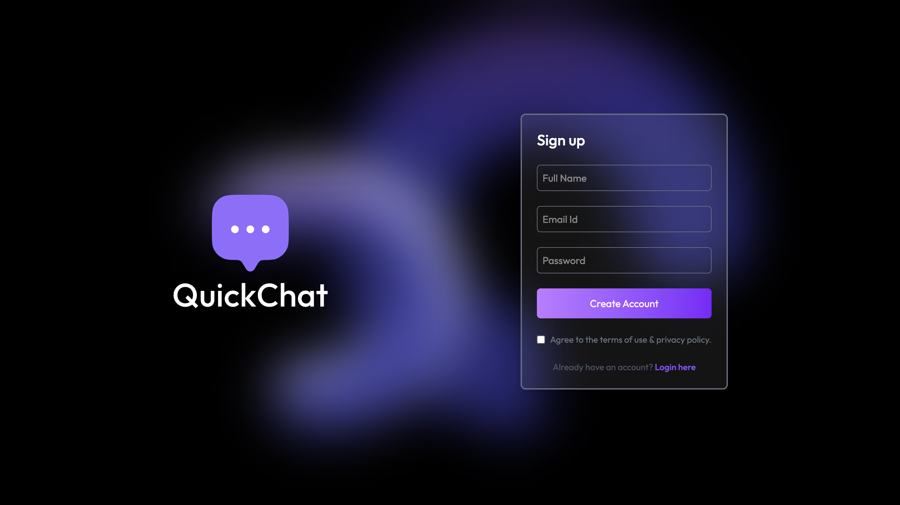
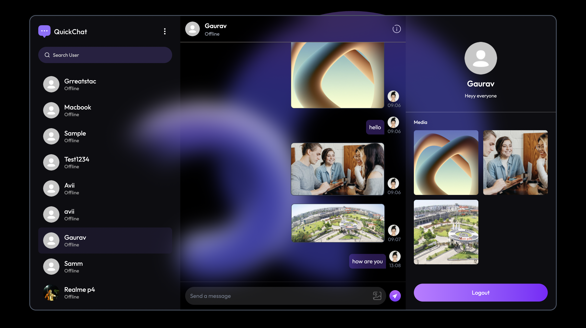
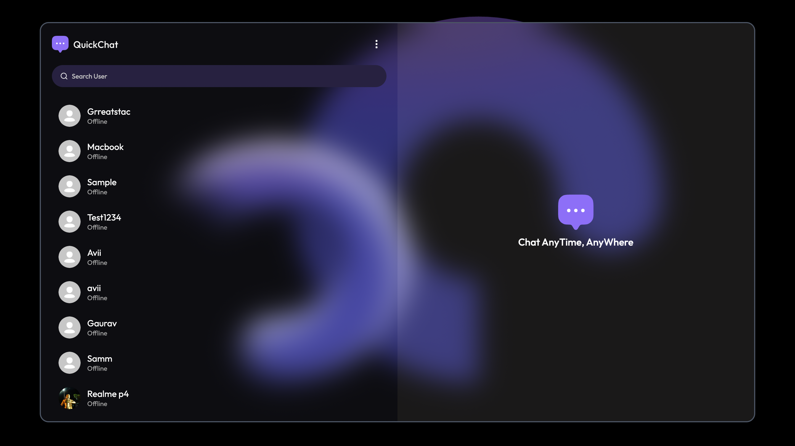
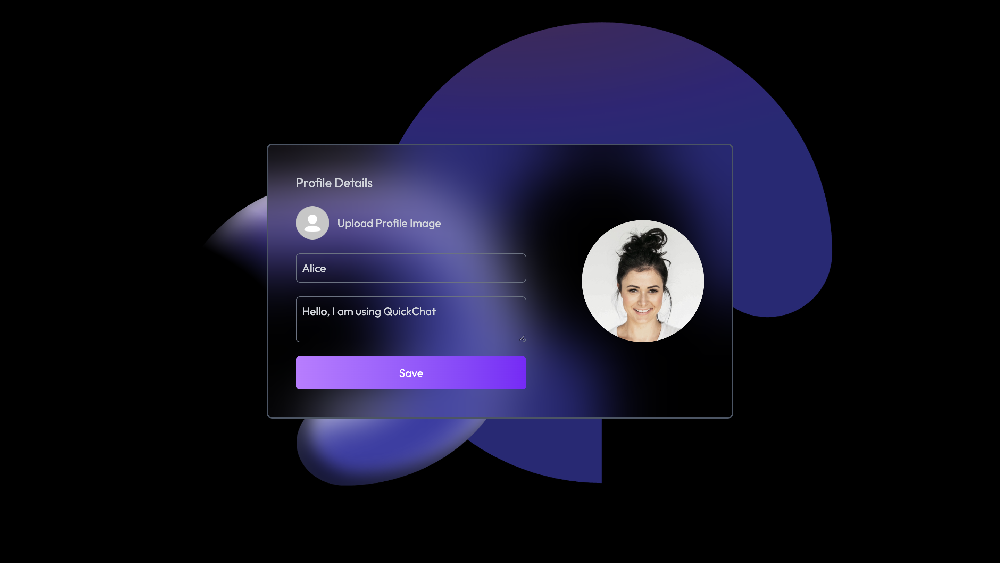

# QuickChat 💬
### Real-Time Chat Application

QuickChat is a real-time messaging web application developed using the MERN Stack. The main purpose of this project is to make communication simple and fast through an easy-to-use chat interface.

Users can create an account, log in, search for other users, exchange messages, share images and manage their profiles. The application also supports online user status and unread message notifications.

🌐 **Live Website:** https://chat-app-rp4h.vercel.app

---

## Features

- **User Authentication:** Users can create an account and log in securely.
- **Real-Time Messaging:** Send and receive messages instantly using Socket.IO.
- **Online Status:** Check whether other users are online or offline.
- **Image Sharing:** Send images during conversations.
- **Profile Management:** Update profile picture, name and bio.
- **User Search:** Search for registered users by their name.
- **Unseen Messages:** Keep track of unread messages.
- **Media Section:** View images shared in conversations.
- **Responsive Design:** Access the application on desktop and mobile devices.
- **Logout:** Securely log out from the application.

## Technologies Used

The project is developed using the following technologies:

| Technology | Purpose |
|---|---|
| React.js | Frontend development |
| Tailwind CSS | Styling and responsive design |
| Node.js | Backend runtime |
| Express.js | Backend API development |
| MongoDB | Database |
| Mongoose | Database management |
| Socket.IO | Real-time communication |
| JWT | User authentication |
| Bcrypt | Password hashing |
| Cloudinary | Image storage |
| Axios | API communication |

## Project Structure

```text
QuickChat/
│
├── client/
│   ├── src/
│   │   ├── assets/
│   │   ├── components/
│   │   ├── pages/
│   │   ├── context/
│   │   └── lib/
│   ├── package.json
│   └── .env
│
├── server/
│   ├── config/
│   ├── controllers/
│   ├── middleware/
│   ├── models/
│   ├── routes/
│   ├── server.js
│   ├── package.json
│   └── .env
│
└── README.md
```

*Note: The structure is a general representation. Update it if your actual folders are different.*

## Application Screenshots

### 1. Login Page


### 2. Chat Interface


### 3. User List


### 4. Edit Profile


## Deployment

The frontend of QuickChat is deployed using Vercel.

**Live Link:** https://chat-app-rp4h.vercel.app

## Future Improvements

Some features I would like to add in future versions:

- Group Chats
- Voice and Video Calling
- Message Editing and Deletion
- Read Receipts
- Emoji Support
- File Sharing

This project was developed as part of my learning journey in full-stack web development. While building QuickChat, I got practical experience with React, Node.js, MongoDB, Socket.IO, authentication, image uploads and application deployment.

---

**Thanks for checking out QuickChat!**
